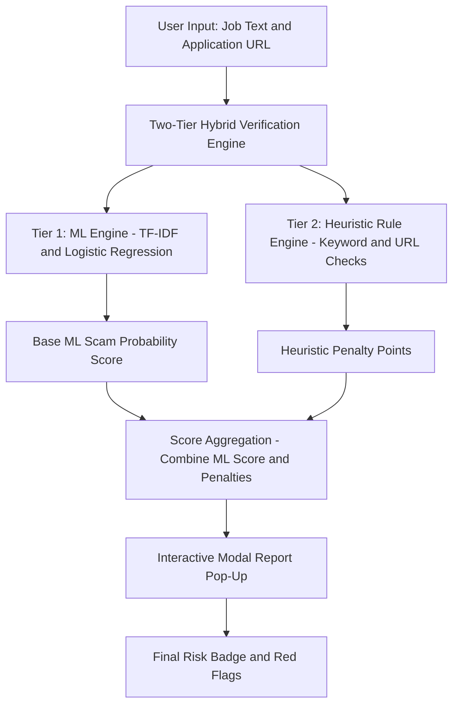

# 🛡️ RecruitShield AI

> **Hybrid Recruitment Fraud & Scam Analyzer**

An enterprise-grade AI system that combines text-based machine learning classification with automated contextual heuristics to protect job seekers from sophisticated employment scams.

---

## 📌 Problem Overview & Core Limitation

Traditional open-source fake job detectors rely almost entirely on standard text classification models, such as TF-IDF combined with basic classifiers.

**The Core Limitation:** Traditional models are *text-blind*. When a scammer drafts a job posting using professional grammar and corporate phrasing while embedding off-platform contact methods (e.g., Telegram, WhatsApp) or requesting upfront fees, pure text models may falsely classify the listing as **Legitimate**.

---

## 🚀 The RecruitShield AI Solution

**RecruitShield AI** addresses this limitation by implementing a **Two-Tier Hybrid Verification Engine**:

1. **Tier 1 – NLP Machine Learning Engine:** A Logistic Regression model trained on job posting vectors using TF-IDF to evaluate linguistic style, structural anomalies, and word frequency patterns.

2. **Tier 2 – Contextual Heuristic Rule Engine:** A security layer that scans for off-platform communication channels (Telegram, WhatsApp), financial phishing indicators (registration fees, wire transfers, USDT/crypto), and suspicious or shortened application URLs (`t.me`, `forms.gle`, `bit.ly`).

---

## ⚙️ How It Works (System Architecture & Execution Flow)

The system uses two complementary verification layers to analyse job descriptions and application URLs.

### System Architecture Diagram



### Execution Flow

**1. Input Ingestion:**  
The user submits a job description and optional application link through a clean, light-mode Streamlit dashboard.

**2. Feature Vectorization & Classification (Tier 1):**  
The raw text is transformed into mathematical vectors using `TfidfVectorizer` and evaluated by a trained `LogisticRegression` classifier to generate a base scam probability score.

**3. Contextual Security Scan (Tier 2):**  
The rule engine inspects the text for suspicious keywords and checks the domain structure of the URL, applying targeted score penalties if high-risk indicators are detected.

**4. Score Aggregation & Modal Output:**  
The ML score and heuristic penalties are combined to calculate the final risk percentage (0–100%). Results are displayed in a centered pop-up modal containing a risk badge, metric breakdown, and specific contextual red flags.

---

## 📋 Requirements & Dependencies

To run this project locally or deploy it to the cloud, ensure you have Python 3.9+ installed along with the following libraries.

### Python Packages (`requirements.txt`)

| Package | Purpose |
|---|---|
| `streamlit` | Interactive web framework and UI |
| `scikit-learn` | Machine learning pipeline (TF-IDF and Logistic Regression) |
| `pandas` | Data processing and manipulation |
| `joblib` | Serialization and loading of model artifacts (`.pkl` files) |

---

## 📁 Repository Structure

```text
RecruitShield-AI/
│
├── app.py                    # Main Streamlit web application and UI engine
├── train_model.py            # ML training script for dataset processing
├── requirements.txt          # Project dependency manifest
├── README.md                 # Project documentation
│
└── models/                   # Local ML model storage
    ├── fake_job_model.pkl    # Trained Logistic Regression classifier
    └── tfidf_vectorizer.pkl  # Fitted TF-IDF feature transformer
```

---

## 🛠️ Local Setup & Execution

Follow these steps to run RecruitShield AI on your local machine.

### 1. Clone the Repository

```bash
git clone https://github.com/AzkaaMulla/RecruitShield-AI.git
```

### 2. Navigate to the Project Directory

```bash
cd RecruitShield-AI
```

### 3. Install Dependencies

```bash
pip install -r requirements.txt
```

### 4. Train Model Artifacts (First-Time Setup)

```bash
python train_model.py
```

### 5. Launch the Streamlit Application

```bash
streamlit run app.py
```

The application will open in your default browser.

---

## 🔒 Security & Privacy Features

- **Zero Persistent Data Storage:** Input text, company details, and application URLs are processed in memory during evaluation and immediately discarded.
- **Proactive Risk Mitigation:** Detects phishing indicators, financial scam requirements, and suspicious contact channels before users interact with potentially fraudulent recruiters.

---

## 👤 Author

**Developer:** Azkaa Mulla

**Domain:** Computer Science Engineering & Data Analytics